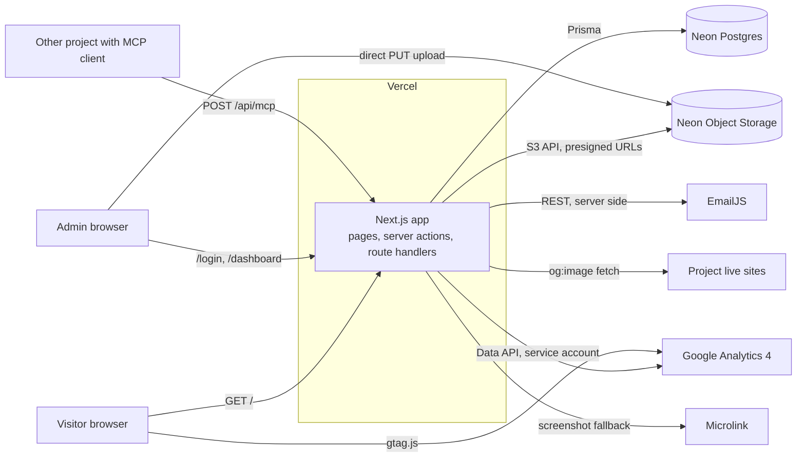
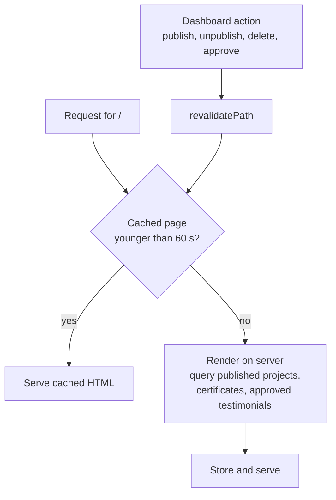
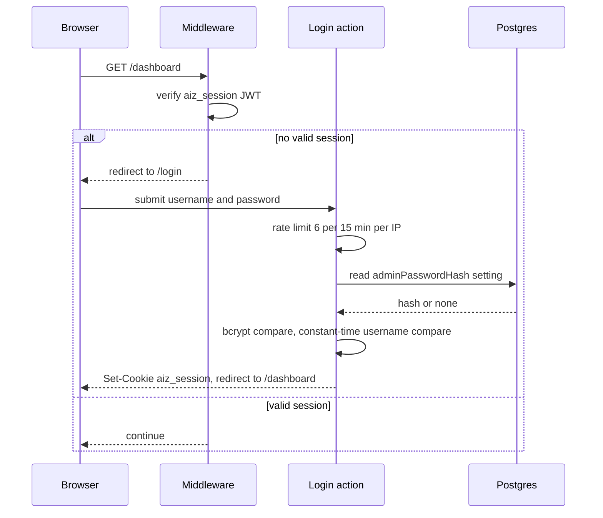
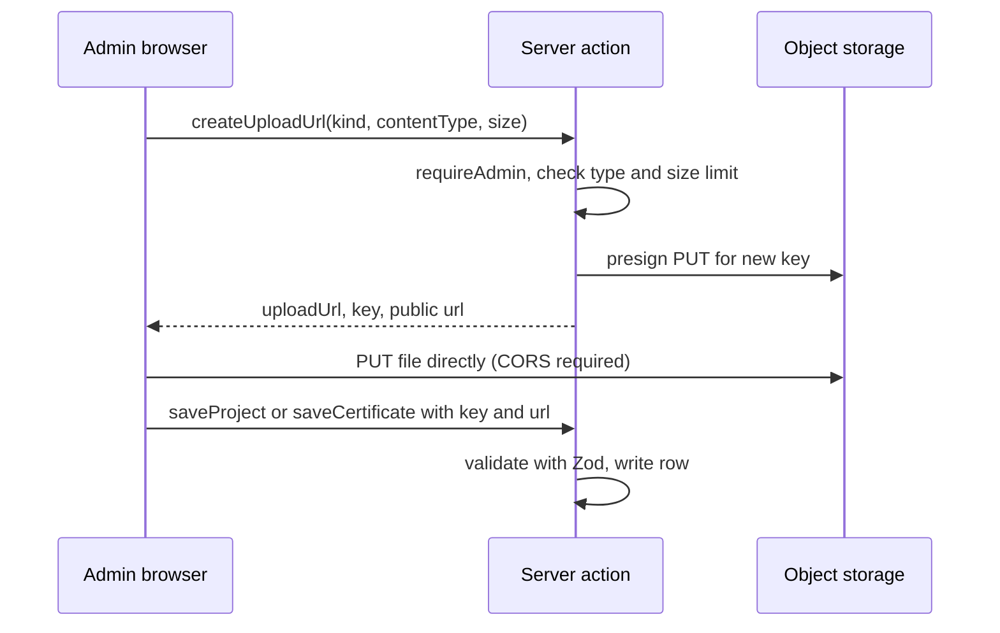
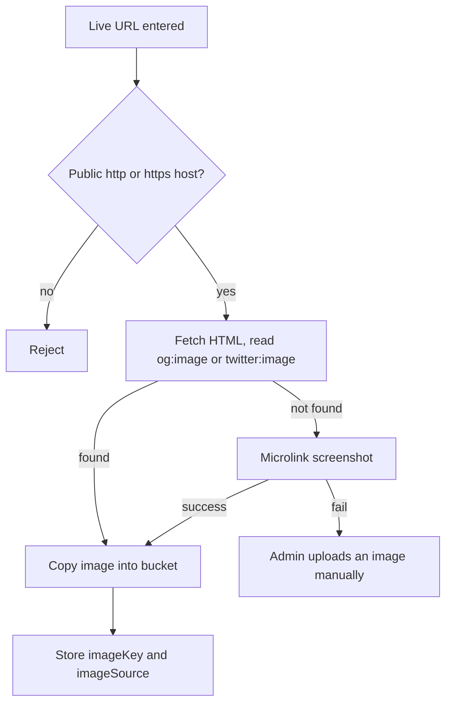
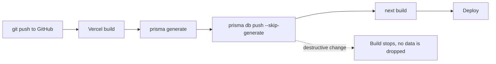

# ARCHITECTURE

How the Alfiz Ilham portfolio is built and why. For exact behavior and limits, see `SPEC.md`. For end-to-end flows, see `WORKFLOW.md`.

## 1. Overview

A single Next.js 15 application (App Router, React 19, TypeScript) deployed on Vercel. It serves the public portfolio and an admin dashboard from one codebase and one database. Everything outside the app is a managed service reached over HTTPS.



## 2. Technology choices

| Concern | Choice | Reason |
| --- | --- | --- |
| Framework | Next.js 15, App Router, Server Components | One deploy for site, dashboard, and API. Server actions replace a separate REST layer |
| Language | TypeScript | Shared types between server actions and client components |
| Styling | Tailwind CSS v4 with CSS variables and a small set of custom classes | Design tokens in one place (`globals.css`) |
| Motion | Framer Motion, Lenis | Reveal and layout animation, smooth scroll. Both disabled by `prefers-reduced-motion` |
| Database | Neon Postgres with Prisma 6 | Serverless Postgres, typed queries, schema pushed on deploy |
| Storage | S3-compatible bucket through the AWS SDK | Provider can change (Neon, R2, S3) without code changes |
| Auth | bcryptjs and `jose` JWT in an HttpOnly cookie | One admin user does not justify an auth framework |
| Validation | Zod | One schema per input, reused for field errors |
| Email | EmailJS REST API from the server | No mail server to run, keys never reach the browser |
| Analytics | GA4 tag for collection, GA Data API for the dashboard | Reuses a free, standard tool |

## 3. Code layout

```
src/
  app/
    (site)/            Public page, layout, contact and view-tracking server actions
    login/             Login page and action
    dashboard/         Dashboard pages and the single actions.ts for all admin mutations
    api/mcp/           MCP server (JSON-RPC over POST)
    api/files/[...key] File proxy for private buckets
    layout.tsx         Fonts, metadata, GA tag, providers
    globals.css        Design tokens and component classes
  components/
    site/              Public sections
    dashboard/         Shell, managers, charts, feedback toasts
    ui/                Button, Modal, Select, Field, Reveal
  lib/
    db, auth, session  Prisma client, credential and session logic
    storage            S3 client, presigned upload, key naming, public URL
    preview            og:image and screenshot resolution, SSRF guard
    email, ga          EmailJS and GA4 clients
    api-keys           MCP key generation and lookup
    settings, content  Stored settings and static portfolio copy
    validation         Zod schemas
    rate-limit         In-memory limiter and client IP helper
  middleware.ts        Session gate for /dashboard and /login
prisma/schema.prisma   Database schema
scripts/hash-password.mjs
```

Rules that keep the layout predictable:

- Files in `lib/` that touch secrets start with `import 'server-only'`. The exception is `session.ts`, which must run in the Edge runtime for middleware.
- All admin mutations live in `dashboard/actions.ts`. Each begins with `requireAdmin()`.
- Server actions return a `Result` object (`{ ok: true, ... }` or `{ ok: false, message, errors }`) instead of throwing, so forms can show field errors.

## 4. Rendering and caching



- The public page is statically rendered with `revalidate = 60`. Dashboard actions call `revalidatePath`, so edits appear immediately rather than after 60 seconds.
- Dashboard pages are dynamic and authenticated on every request.
- Interactive pieces (motion, scroll, modals, forms) are isolated client components. Server Components render static structure and fetch data.

## 5. Authentication and session



Two layers of protection: middleware redirects unauthenticated requests, and every page and server action calls `requireAdmin()` again. A bypass of the matcher therefore still cannot mutate data.

Password source order: database override (set in Settings) first, then `ADMIN_PASSWORD_HASH_B64`.

## 6. Upload path



Files never pass through the Vercel function, which avoids body size limits and keeps function time short. The bucket must allow CORS `PUT` and `GET` from the site origin.

For a private bucket, `S3_PUBLIC_URL` stays empty and URLs point to `/api/files/<key>`. The route only serves keys that match the `projects/` or `certificates/` prefix pattern.

## 7. MCP testimonial intake

`/api/mcp` is a minimal MCP server implemented as one `POST` handler. It supports `initialize`, `ping`, `tools/list`, and `tools/call` for a single tool. It is stateless, so it fits serverless without sessions.

Security decisions:

- Keys are random, high entropy, and stored as SHA-256 hashes. A database leak does not reveal usable keys.
- One key per client project allows revoking one project without affecting others.
- Submissions are never published directly. They enter as `PENDING` and require approval.
- Per-key rate limit of 60 requests per minute.

## 8. Project preview resolution



Copying the image into the bucket protects against broken previews when the source site changes or blocks hotlinking.

## 9. Security model

| Threat | Mitigation |
| --- | --- |
| Unauthorized dashboard access | Middleware plus `requireAdmin()` in every page and action |
| Credential guessing | bcrypt cost 12, 6 attempts per 15 minutes per IP, constant-time comparisons |
| Session theft | HttpOnly, SameSite Lax, Secure in production, 7 day expiry, HS256 signature |
| Contact form spam | Zod validation, honeypot field, 4 per 10 minutes per IP |
| SSRF through preview fetch | Scheme check, private and local host blocklist, timeouts |
| Leaked MCP key | Only hashes stored, revocable, per project |
| Stored file abuse | Type and size checks before presigning, key prefix allowlist in the file proxy |
| Secret exposure to the browser | Secrets only in server modules marked `server-only`. Only `NEXT_PUBLIC_*` values reach the client |

Known limits: the rate limiter is in memory and per instance, DNS rebinding is not fully covered by the host blocklist, and there is no content moderation on testimonials beyond manual approval.

## 10. Deployment



- `vercel-build` pushes the schema on every deploy, so schema and code ship together.
- `prisma db push` refuses changes that would delete data unless forced, so a bad schema edit fails the build instead of damaging data.
- Environment variables are set per environment in Vercel. The `.env` file is for local use and is git-ignored.
- `DATABASE_URL` uses the pooler for runtime queries. `DIRECT_URL` bypasses the pooler for schema changes.

## 11. Failure behavior

| Failure | Result |
| --- | --- |
| EmailJS down or misconfigured | Contact message is still saved. Auto-reply is skipped. A failed dashboard reply is stored with its error |
| Storage not configured | Upload buttons show a clear error. The rest of the dashboard works |
| GA not configured or API error | Analytics page shows a not-configured or error state |
| Preview fetch fails | Admin uploads an image manually |
| Database unavailable | Public page serves the last cached render until revalidation succeeds. Dashboard shows the error boundary |

## 12. Decisions and trade-offs

| Decision | Alternative | Why this way | Cost |
| --- | --- | --- | --- |
| Server actions for all mutations | REST or tRPC API | Less code, typed end to end | Not callable by external clients, which is acceptable here |
| Single admin account | Auth.js or a hosted auth service | One user, fewer moving parts | No multi-user or roles without rework |
| In-memory rate limiter | Redis | No extra service or cost | Per-instance windows, weaker under many instances |
| Static copy in `content.ts` | CMS | Content changes rarely and is reviewed in git | Editing copy needs a deploy |
| Projects, certificates, testimonials in the database | All static | Owner updates them without a deploy | Needs the database to be available at revalidation |
| Presigned direct upload | Upload through the server | Avoids function body limits | Needs bucket CORS |
| Own MCP route | A third-party form tool | Lets other projects submit feedback with revocable keys | Small protocol surface to maintain |
